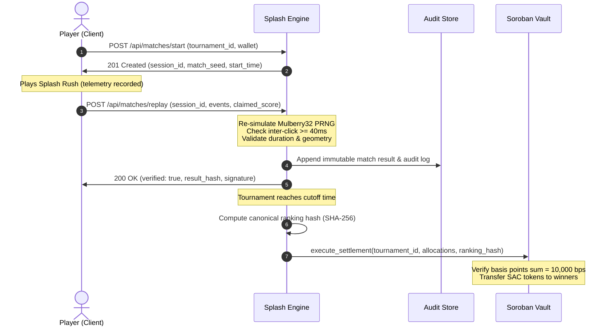

# 🛡️ Stellar Splash Engine: Audit & Security Specification

## 1. Executive Summary

The **Stellar Splash Replay Engine** provides trustless, deterministic verification of off-chain competitive game sessions for on-chain Soroban escrow settlement. In decentralized gaming, clients cannot be trusted to self-report scores. Conversely, executing frame-by-frame game logic directly on the Soroban virtual machine is prohibitively expensive in terms of CPU instructions and ledger storage.

Stellar Splash resolves this dilemma through **Optimistic Off-Chain Deterministic Simulation with Cryptographic Attestation**:
1. Clients record fine-grained, timestamped player input telemetry during gameplay.
2. The telemetry payload is submitted to the Replay Engine for automated verification.
3. The engine deterministically re-simulates the match against the exact pseudorandom target sequence derived from the match seed.
4. If and only if the simulated score, timings, and physical geometries match the client claim without violating anti-cheat heuristics, the engine issues a signed HMAC-SHA256 attestation.
5. On tournament finalization, the top attested scores are compiled into a canonical ranking hash that authorizes on-chain payout distribution in Soroban contract `CACHWJEZY6JN36VFACWRQ7FP4T5EPRRRNBVLOSFHXTJHETZY36JD7QYJ`.

---

## 2. Threat Model & Attack Vectors

The engine is engineered to mitigate five primary adversarial attack vectors:

| Attack Vector | Threat Mechanism | Engine Mitigation |
| :--- | :--- | :--- |
| **Score Spoofing** | Adversary submits arbitrary high scores directly to API without playing. | Engine re-calculates score entirely from primitive input events; submitted score is completely ignored during ranking. |
| **Macro Automation / Autoclickers** | Adversary uses software autoclickers or hardware bots to click targets at inhuman speeds. | Strict minimum inter-click interval bounding ($\Delta t \ge 40\text{ ms}$), physical reaction time analysis, and click jitter heuristics. |
| **Replay Hijacking & Reuse** | Adversary captures another player's valid telemetry payload and resubmits it under their own address. | Telemetry is cryptographically bound to `(tournament_id, session_id, player_wallet)`. Replays for mismatched wallets or expired sessions are instantly rejected. |
| **Spatial Teleportation** | Bot scripts simulate instantaneous cursor movement across non-contiguous screen coordinates. | Cursor velocity boundary checks ($v_{max} = \frac{\Delta d}{\Delta t} \le 5000\text{ px/sec}$) and target bounding box collision verification. |
| **Denial of Service (DoS)** | Adversary floods the engine with infinite event arrays or malicious payloads. | Request size limits (1MB), rate limiting (100 req/min per IP), bounded event stream lengths ($\le 1,000$ events per 30s match), and Zod schema validation. |

---

## 3. Anti-Cheat Engine Heuristics

The `ReplayService` executes a multi-layer evaluation pipeline across every submitted match session:

### 3.1. Inter-Click Timing Invariant ($\Delta t \ge 40\text{ ms}$)
Human neuromotor reaction and mechanical switch actuation limits prevent humans from executing sustained clicks faster than 25 clicks per second ($40\text{ ms}$ per cycle).
- Any two consecutive click events with $(t_{i} - t_{i-1}) < 40\text{ ms}$ immediately trigger an anti-cheat violation (`AntiCheatViolation: Click interval too short`).
- The match is marked `verified: false` and discarded from leaderboard eligibility.

### 3.2. Match Duration Bounding ($T_{min} \le T_{elapsed} \le T_{max}$)
A standard Splash Rush round is configured for 30 seconds ($30,000\text{ ms}$).
- **Minimum Allowable Duration**: $T_{min} = 25,000\text{ ms}$ (accounting for early balloon hazard pops).
- **Maximum Allowable Duration**: $T_{max} = 35,000\text{ ms}$ (accounting for network transmission latency).
- Matches concluding outside this window are rejected with `InvalidMatchDuration`.

### 3.3. Spatial Geometry & Coordinate Boundaries
Every target balloon exists within a canonical 2D coordinate space $(X, Y) \in [0, 800] \times [0, 600]$ with radius $R \in [20, 60]\text{ px}$.
- Click coordinates $(x_c, y_c)$ must satisfy $(x_c - x_t)^2 + (y_c - y_t)^2 \le (R + \epsilon)^2$, where $\epsilon = 5\text{ px}$ accounts for sub-pixel anti-aliasing.
- Clicks occurring outside the viewport canvas or when no target is present do not register score points and increment the missed-click penalty counter.

### 3.4. Deterministic PRNG Target Generation
To ensure matches cannot be pre-computed:
- The game session seed is computed as:
  $$\text{Seed} = \text{SHA-256}(\text{tournament\_id} \mathbin{\Vert} \text{session\_id} \mathbin{\Vert} \text{player\_wallet})$$
- A 32-bit Mulberry32 PRNG initializes using this seed.
- All target spawn coordinates, float velocities, target types (standard, golden, hazard), and timing intervals are 100% deterministic functions of this sequence.
- The Replay Engine regenerates the identical target sequence during verification; if an event claims to pop a balloon at $(x, y)$ where no balloon existed according to the PRNG timeline, the match is rejected.

---

## 4. Cryptographic Attestation Architecture

### 4.1. Canonical Result Hash
Upon passing all simulation checks, the engine derives an immutable result hash:
$$\text{ResultHash} = \text{SHA-256}\Big(\text{session\_id} \mathbin{\Vert} \text{player\_wallet} \mathbin{\Vert} \text{simulated\_score} \mathbin{\Vert} \text{verified\_flag}\Big)$$

### 4.2. Ranking Hash Commitment
At tournament conclusion, the top $N$ verified participants are ordered monotonically by score:
$$\text{RankingHash} = \text{SHA-256}\Big(\bigoplus_{i=1}^N \text{rank}_i \mathbin{\Vert} \text{wallet}_i \mathbin{\Vert} \text{score}_i \mathbin{\Vert} \text{result\_hash}_i\Big)$$
This `RankingHash` is submitted directly into the Soroban contract method `execute_settlement` as a cryptographic commitment, ensuring that on-chain payouts correspond strictly to audited gameplay.

---

## 5. Persistence & Invariant Guarantees

1. **State Immutability**: Once a match result is verified and stored for a given `session_id`, it cannot be modified or re-submitted.
2. **Atomic Snapshots**: The engine writes state snapshots using atomic rename semantics (`.tmp` -> target file), preventing corrupted state files across process crashes or power interruptions.
3. **Graceful Shutdown**: On `SIGTERM` or `SIGINT`, the `ShutdownService` executes all registered flush hooks, drains active HTTP connections, and closes file descriptors cleanly within a 5,000ms window.
4. **Zero Memory Leaks**: All in-memory event buffers and replay caches enforce maximum entry limits (LRU eviction) to prevent heap exhaustion.

---

## 6. Security Invariant Matrix

| ID | Invariant Description | Enforcement Layer | Failure Action |
| :--- | :--- | :--- | :--- |
| **INV-01** | Minimum click interval $\ge 40\text{ ms}$ | Engine (`ReplayService`) | Reject replay; log anti-cheat alert |
| **INV-02** | Valid match duration $25\text{s} \le T \le 35\text{s}$ | Engine (`ReplayService`) | Reject replay with `INVALID_DURATION` |
| **INV-03** | Canonical Mulberry32 coordinate match | Engine (`ReplayService`) | Reject replay with `SIMULATION_MISMATCH` |
| **INV-04** | Tournament allocation basis points sum $= 10,000$ | Soroban Contract | Abort transaction with `InvalidAllocations` |
| **INV-05** | Agreement version locked prior to start | Soroban Contract | Reject state transition with `AgreementNotLocked` |
| **INV-06** | Vault balance $\ge$ total tournament escrow | Soroban Contract | Abort settlement with `InsufficientVaultBalance` |
| **INV-07** | Rate limit: $\le 100\text{ requests/min}$ per IP | HTTP Middleware | HTTP 429 Too Many Requests |

---
*Stellar Splash Security Specification v1.0 — Maintained by JoeADCodes*
