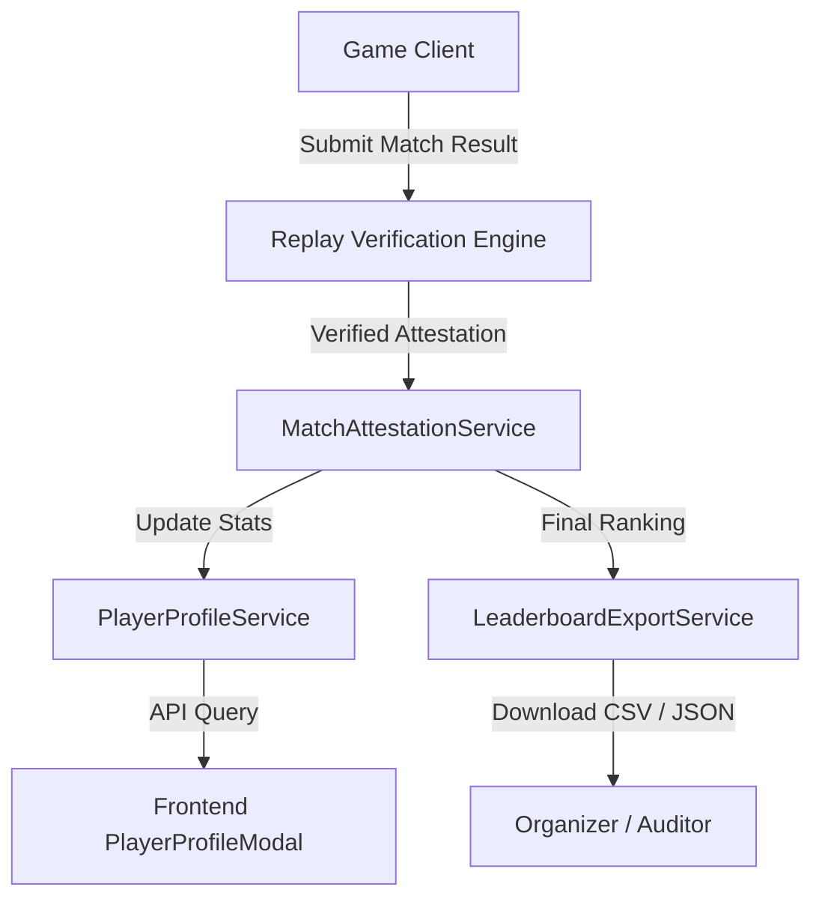

# Stellar Splash Engine: Player Reputation & Leaderboard System

## 1. Overview
The Stellar Splash Engine aggregates verifiable match results across decentralized tournament pools, maintaining cryptographically backed player career profiles, competitive leaderboards, and audit exports.

---

## 2. Core Architecture



---

## 3. Career Statistics Aggregation

`PlayerProfileService` tracks player performance across all entered tournaments:

- **Win Rate Percentage**: $\text{Win Rate} = \text{round}\left(\frac{\text{Wins}}{\text{Matches Played}} \times 100\right)$
- **Cumulative Earnings**: Sum of all confirmed Soroban vault payout distributions across verified asset types (USDC, XLM, AQUA).
- **Peak Standing**: Best finishing position (e.g., Rank #1) attained across all historical tournaments.
- **Activity Lifespan**: First active timestamp and latest match timestamp for active player tenure metrics.

---

## 4. Leaderboard Export Standards

To facilitate transparent prize distribution audits and compliance reporting, `LeaderboardExportService` provides two standard serialization formats:

### 4.1 Formatted CSV Specification
```csv
Rank,Player Wallet,Score,Prize Share (Bps),Prize Amount,Asset,Status
1,"GBBD47IF6LWK7P7MDEVSCWR7DPUWV3NY3DTQEVFL4NAT4AQH3ZLLFLA5",1500,6000,60.0000,"XLM","SETTLED"
2,"GA7QYNF7SOWQ3GLR2BGMZEHXAVIRZA4KVWLTJJFC7MGXUA74P7UJVWAC",1100,4000,40.0000,"XLM","SETTLED"
```

### 4.2 Machine-Readable JSON Export
```json
{
  "tournamentId": "tourney-101",
  "title": "Splash Rush Championship",
  "prizeAsset": "USDC",
  "totalPrizePool": 100,
  "exportedAt": 1730172000000,
  "recordCount": 2,
  "rankings": [
    {
      "rank": 1,
      "playerWallet": "GBBD...",
      "score": 1500,
      "prizeShareBps": 6000,
      "prizeAmount": 60,
      "asset": "USDC",
      "status": "SETTLED"
    }
  ]
}
```

---

## 5. Gas Forecasting & Network Congestion
`GasPriceEstimatorService` forecasts transaction fees dynamically according to current Stellar network traffic tiers:

| Congestion Tier | Multiplier | Creation Fee | Settlement Fee | Inclusion Priority |
| :--- | :--- | :--- | :--- | :--- |
| **LOW** | 1.0x | 100,000 Stroops | 250,000 Stroops | Standard |
| **NORMAL** | 1.2x | 120,000 Stroops | 300,000 Stroops | Standard |
| **HIGH** | 1.8x | 180,000 Stroops | 450,000 Stroops | Expedited |
| **EXTREME** | 2.5x | 250,000 Stroops | 625,000 Stroops | Critical |
